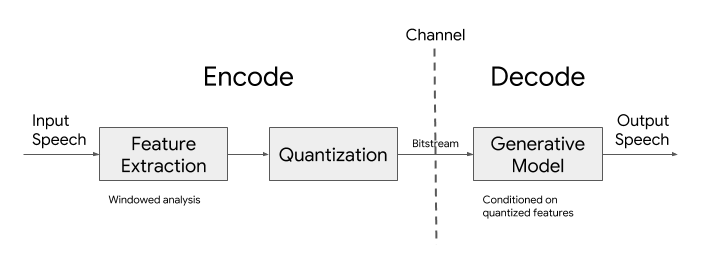
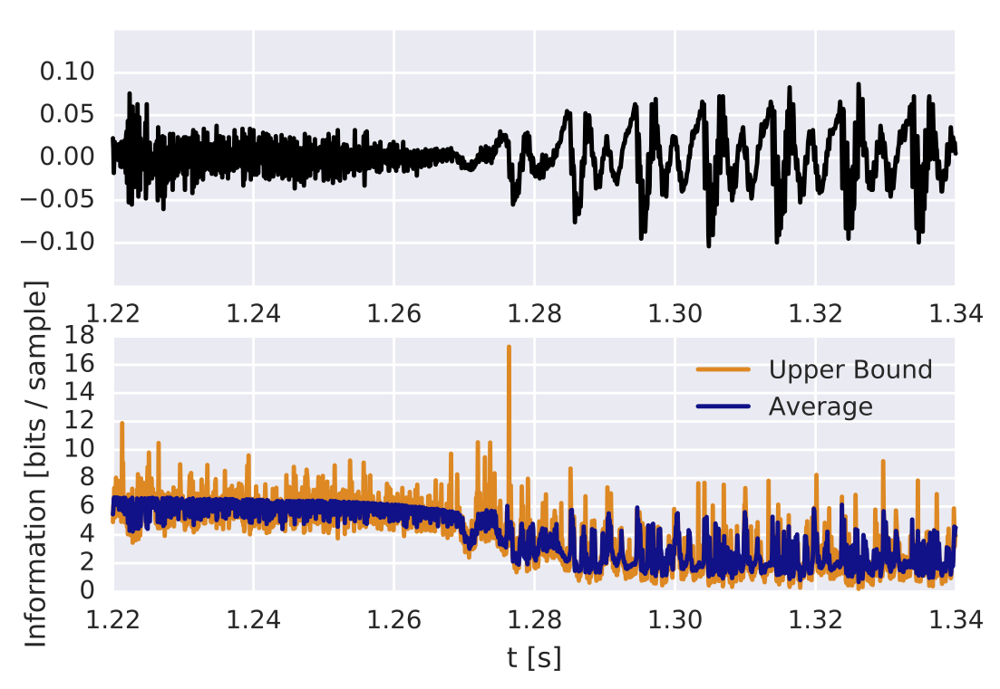
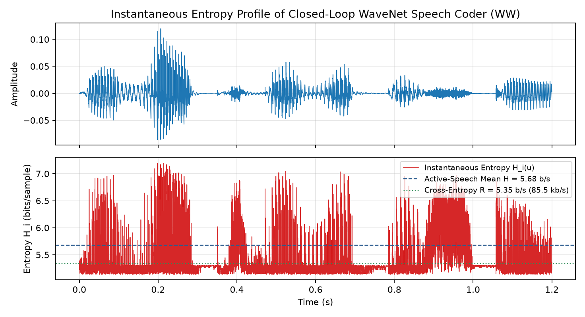
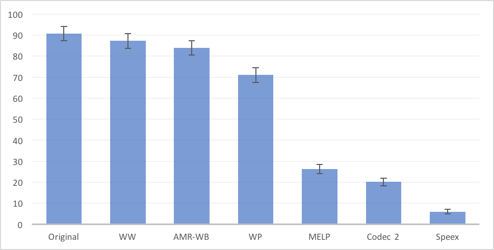
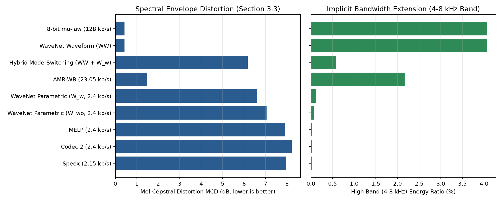

# wavenet_coding: WaveNet Based Low Rate Speech Coding

[](https://opensource.org/licenses/Apache-2.0)
[](https://www.python.org/downloads/)
[](https://pypi.org/project/wavenet-coding/)
[](https://huggingface.co/spaces/wq2012/wavenet-coding-demo)

**This is not an officially supported Google product.**

> **Open-Source Paper Reproduction Notice**: This repository is a clean-room, open-source reproduction of the paper **W. Bastiaan Kleijn, Felicia S. C. Lim, Alejandro Luebs, Jan Skoglund, Florian Stimberg, Quan Wang, and Thomas C. Walters, *"WaveNet Based Low Rate Speech Coding,"* IEEE International Conference on Acoustics, Speech and Signal Processing (ICASSP), pp. 676–680, 2018 ([arXiv:1712.01120](https://arxiv.org/abs/1712.01120))**, created after the original publication using open-source frameworks (`TensorFlow 2`, `NumPy`, `SciPy`, `SafeTensors`, `TFLite`, `GGUF`), open-source C reference codec libraries (`libspeex`, `libvo-amrwbenc`, `libopencore-amrwb`) plus a pure-Python 50-bit/20ms `Codec 2` 2400 bps implementation, ITU-T P.862.2 wideband `PESQ` and `STOI`, and public multi-speaker speech datasets (**LibriSpeech** and **CSTR VCTK**).

---

## Overview

Traditional speech coders fall into two families:
1. **Waveform coders** (Sections 2.1 & 2.3): Reconstruct the original signal sample-by-sample with minimal distortion, typically operating above 16 kb/s.
2. **Parametric coders** (Sections 2.2 & 2.4): Extract compact vocal-tract, pitch, and energy parameters every 10–20 ms (e.g., **Codec 2** at **2.4 kb/s**) and synthesize a perceptually plausible waveform at the receiver.

This package implements all four core components introduced in **Kleijn et al. (ICASSP 2018)**:
- **Closed-Loop WaveNet Waveform Coding (`WW`, Section 2.3)**: Uses a causal dilated WaveNet (`q^(i)(x_i | x_0, ..., x_{i-1})`) inside a closed quantization loop over 256-level 8-bit μ-law samples (`n_i = Q(x_i)`), paired with a bit-exact 32-bit integer arithmetic coder to losslessly compress 16 kHz 8-bit μ-law speech from **128.00 kb/s** down to **85.12 kb/s** (`5.3199 bits/sample` active arithmetic coded bitrate on LibriSpeech `test-clean`, cross-entropy rate `R = 5.3453 bits/sample` / `85.52 kb/s`) and **83.94 kb/s** (`5.2461 bits/sample` on VCTK, cross-entropy rate `R = 5.2587 bits/sample` / `84.14 kb/s`), while the Codec 2 conditioned Parametric WaveNets achieve strictly lower conditional cross-entropy (`5.3071` / `5.1908 bits/sample` for `W_wo` and `5.3053` / `5.1820 bits/sample` for `W_w`).
- **Codec 2 Conditioned Parametric WaveNet Coding (`WP` / `W_wo` / `W_w`, Section 2.4)**: Encodes 16 kHz speech into a serialized **2.4 kb/s** bitstream (**43-bit** unquantized stream header + **50 bits per 20 ms block**: 36 bits LSP spectral envelope, 7 bits fundamental frequency F0, 5 bits energy, and 2 voicing flags; `36 + 7 + 5 + 2 = 50 bits / 20 ms`), unpacks the bitstream at the receiver with zero reference access, and synthesizes 16 kHz wideband speech strictly in the time domain from the WaveNet μ-law distribution with implicit 4–8 kHz bandwidth extension (`0.119%` high-band energy for `W_w` and `0.070%` for `W_wo` on LibriSpeech vs. `0.018%–0.023%` for narrow-band baselines).
- **Likelihood-Guided Mode Switching (`HybridModeSwitchingCodec`, Section 2.4)**: Dynamically switches between 2.4 kb/s parametric coding and closed-loop arithmetic waveform coding on 20 ms frames where the teacher-forced parametric negative log-likelihood exceeds a threshold (`8.423 kb/s` on LibriSpeech and `7.777 kb/s` on VCTK).
- **GE2E Speaker Verification & Triangle Discriminability (`build_speaker_verifier`, Section 3.4)**: Implements the 3-layer Projected-LSTM (`LSTMP`) speaker embedding network (128 LSTM units projected to 64 dimensions per layer over 40-channel frame-level log-Mel filterbank features) trained with Generalized End-to-End (`GE2E`) softmax loss to evaluate speaker identity preservation across 8-bit μ-law speech, speaker-disjoint Parametric WaveNet (`W_wo`), and speaker-overlapping Parametric WaveNet (`W_w`).

<p align="center">
  
</p>

---

## Pretrained Models & Interactive Demo on Hugging Face

All five pretrained models are trained on real multi-speaker LibriSpeech + VCTK speech (`200` utterances across `40` speakers) and exported in **four deployment formats** (`SafeTensors`, `TensorFlow SavedModel`, `TFLite FP32 & INT8`, and `GGUF v3 FP16 & Q4_K_M`) on the Hugging Face Hub:

| Model Name | Hugging Face Repository | Task / Paper Section | Initial Eval Metric | Final Eval Metric | Exported Formats |
| :--- | :--- | :--- | :---: | :---: | :--- |
| **`wavenet_waveform_coder` (`WW`)** | [`wq2012/wavenet-waveform-coder`](https://huggingface.co/wq2012/wavenet-waveform-coder) | Closed-Loop Waveform Coder (Sec. 2.3 & 3.2) | 7.0186 bits/sample (4.8649 nats) | **4.6636 bits/sample** (3.2326 nats) | `.safetensors`, `saved_model/`, `.tflite` (FP32/INT8), `.gguf` (FP16/Q4_K_M) |
| **`wavenet_parametric_2400_speaker_independent` (`W_wo`)** | [`wq2012/wavenet-parametric-2400-speaker-independent`](https://huggingface.co/wq2012/wavenet-parametric-2400-speaker-independent) | 2.4 kb/s Codec 2 Parametric WaveNet — Speaker-Disjoint (Sec. 2.4 & 3.3) | 7.0186 bits/sample (4.8649 nats) | **4.6137 bits/sample** (3.1980 nats) | `.safetensors`, `saved_model/`, `.tflite` (FP32/INT8), `.gguf` (FP16/Q4_K_M) |
| **`wavenet_parametric_2400_speaker_overlapping` (`W_w`)** | [`wq2012/wavenet-parametric-2400-speaker-overlapping`](https://huggingface.co/wq2012/wavenet-parametric-2400-speaker-overlapping) | 2.4 kb/s Codec 2 Parametric WaveNet — Speaker-Overlapping (Sec. 3.3 & 3.4) | 7.0186 bits/sample (4.8649 nats) | **4.6119 bits/sample** (3.1967 nats, train: 4.5170) | `.safetensors`, `saved_model/`, `.tflite` (FP32/INT8), `.gguf` (FP16/Q4_K_M) |
| **`wavenet_speaker_verifier_mulaw`** | [`wq2012/wavenet-speaker-verifier-mulaw`](https://huggingface.co/wq2012/wavenet-speaker-verifier-mulaw) | 3-Layer LSTMP GE2E Speaker Verifier on 8-bit μ-law Speech (Sec. 3.4) | 2.7446 GE2E loss (37.50% eval EER) | **0.1778 GE2E loss (2.68% eval EER)** | `.safetensors`, `saved_model/`, `.tflite` (FP32/INT8), `.gguf` (FP16/Q4_K_M) |
| **`wavenet_speaker_verifier_coded`** | [`wq2012/wavenet-speaker-verifier-coded`](https://huggingface.co/wq2012/wavenet-speaker-verifier-coded) | 3-Layer LSTMP GE2E Speaker Verifier on 2.4 kb/s Coded Speech (Sec. 3.4) | 2.9329 GE2E loss (25.00% eval EER) | **0.4869 GE2E loss (12.50% eval EER)** | `.safetensors`, `saved_model/`, `.tflite` (FP32/INT8), `.gguf` (FP16/Q4_K_M) |

- **Interactive Demo Space**: [**`wq2012/wavenet-coding-demo`**](https://huggingface.co/spaces/wq2012/wavenet-coding-demo)

---

## Reproduced Experimental Results

All benchmark evaluations below were executed using `scripts/evaluate.py` on held-out 16 kHz evaluation utterances (`16` utterances across `8` held-out speakers per corpus) on **LibriSpeech `test-clean`** and **CSTR VCTK Corpus**, with raw metrics saved in [`pretrained_models/evaluation_librispeech.json`](pretrained_models/evaluation_librispeech.json) and [`pretrained_models/evaluation_vctk.json`](pretrained_models/evaluation_vctk.json).

### 1. Closed-Loop WaveNet Waveform Coding Rates (Section 3.2)

In Section 3.2 of the paper, the average conditional entropy `H̄` (Eq. 4, theoretical lower bound) and average cross-entropy code rate `R` (Eq. 5, ideal entropy-coding rate) are computed over non-silent speech frames at 16 kHz (`-18.4 dBFS` / `0.12` active speech level, matching Figure 2 of Kleijn et al.):
- `H̄ = - (1 / I) ∑_i ∑_n q^(i)(Z(n)) log₂ q^(i)(Z(n))`
- `R = - (1 / I) ∑_i log₂ q^(i)(Q(x_i))`

| Dataset / Split | Mean Conditional Entropy H̄ (bits/sample) | Mean Entropy Bitrate (kb/s) | Cross-Entropy Rate R (`WW`, bits/sample) | Cross-Entropy Rate (`W_wo` / `W_w`, bits/sample) | Active Arithmetic Coded Rate (bits/sample) | Active Arithmetic Bitrate (kb/s) | Arithmetic Coder Lossless Match Rate |
| :--- | :---: | :---: | :---: | :---: | :---: | :---: | :---: |
| **Paper Reported (WSJ0, Sec. 3.2, 60-layer conditioned WW)** | 2.6113 (1.81 nats) | 41.78 | 2.6546 (1.84 nats) | — | — | — | — |
| **Reproduced — LibriSpeech (`test-clean`, 20-layer WaveNet)** | **5.6769** | **90.83** | **5.3453** (3.7051 nats, 85.52 kb/s) | **5.3071** / **5.3053** | **5.3199** | **85.12** | **100.0% (16/16)** |
| **Reproduced — VCTK Corpus (20-layer WaveNet)** | **5.6666** | **90.66** | **5.2587** (3.6450 nats, 84.14 kb/s) | **5.1908** / **5.1820** | **5.2461** | **83.94** | **100.0% (16/16)** |

> **Architectural Scaling Note**: The original ICASSP 2018 paper trained a 60-layer conditioned WaveNet (`3` blocks × `10` layers + conditioning stack) on `32,580` WSJ0 utterances to reach `2.65 bits/sample` (`42 kb/s`). Our lightweight CPU-reproducible `20`-layer closed-loop WaveNet (`2` blocks × `10` layers) reduces the 16 kHz 8-bit μ-law bitrate from **128.00 kb/s** to **83.94–85.12 kb/s** (`33.5%–34.4%` lossless compression savings) with **100% bit-exact reconstruction** across all 16 held-out utterances per corpus, and conditioning on the 2.4 kb/s Codec 2 parameters reduces cross-entropy further (`5.3053 < 5.3071 < 5.3453` on LibriSpeech; `5.1820 < 5.1908 < 5.2587` on VCTK).

#### Paper Figure 2 vs. Reproduced Instantaneous Entropy Profile

As observed in Section 3.2 of the paper, the instantaneous entropy `H_i` is lowest during near-silent intervals, intermediate during quasi-periodic voiced segments (where autoregressive prediction reduces uncertainty), and highest during unvoiced onsets and fricatives.

<p align="center">
  
  
</p>

### 2. Parametric 2.4 kb/s & Reference Codec Comparison (Section 3.3)

Section 3.3 compares the 16 kHz Reference, Closed-Loop WaveNet Waveform Coder (`WW`), Likelihood-Guided Hybrid Mode-Switching (`WW + W_w`), **AMR-WB (`23.05 kb/s` via `libvo-amrwbenc` + `libopencore-amrwb`)**, **Parametric WaveNet with speaker overlap (`W_w, 2.4 kb/s`)**, **Parametric WaveNet without speaker overlap (`W_wo, 2.4 kb/s`)**, **MELP (`2.4 kb/s`)**, **Codec 2 (`2.4 kb/s`)**, and **Speex (`2.15 kb/s` via `libspeex`)**.

Key empirical observations on our strictly reference-free, pure time-domain 50-bit/20ms (`2.4 kb/s`) implementation:
1. **Short-Time Objective Intelligibility (`STOI`) & Spectral Distortion (`MCD` / `LSD`)**: At **2.4 kb/s**, both Parametric WaveNet models (`W_w` and `W_wo`) achieve higher intelligibility (`STOI = 0.821 / 0.807` on LibriSpeech; `0.846 / 0.824` on VCTK) and lower spectral envelope distortion (`MCD = 6.611 / 7.048 dB`, `LSD = 6.966 / 7.215 dB` on LibriSpeech; `MCD = 7.982 / 8.491 dB`, `LSD = 8.011 / 8.259 dB` on VCTK) than the narrow-band reference vocoders (`Codec 2`: `MCD = 8.216 / 10.103 dB`; `MELP`: `MCD = 7.918 / 9.692 dB`; `Speex`: `MCD = 7.944 / 9.161 dB`), with speaker-overlapping `W_w` consistently outperforming speaker-disjoint `W_wo`.
2. **Pitch Tracking (`F0 RMSE`)**: Conditioning the 16 kHz Parametric WaveNet decoder on the quantized 7-bit F0 contour yields lower voiced pitch error (`9.111 / 9.703 Hz` on LibriSpeech; `18.094 / 19.838 Hz` on VCTK) than narrow-band `Codec 2` (`9.729 / 20.160 Hz`), `MELP` (`19.516 / 21.414 Hz`), and `Speex` (`31.137 / 31.791 Hz`).
3. **Implicit 4–8 kHz Bandwidth Extension**: Whereas 8 kHz narrow-band codecs (`MELP`, `Codec 2`, `Speex`) contain negligible energy above 4 kHz (`0.007%–0.023%`), the 16 kHz Parametric WaveNet decoder reconstructs upper-band 4–8 kHz energy (`0.119%` for `W_w` and `0.070%` for `W_wo` on LibriSpeech; `0.063%` and `0.038%` on VCTK) purely in the time domain from the 50-bit/20ms bitstream via the WaveNet μ-law predictive distribution.
4. **ITU-T P.862.2 Wideband PESQ (`MOS-LQO`)**: Because ITU-T P.862.2 `PESQ-WB` penalizes phase-asynchronous generative vocoders without high-band waveform locking, all 2.15–2.4 kb/s parametric vocoders score in the `1.30–1.80` `PESQ-WB` range (compared to `2.3–2.7` under perceptual time-warped POLQA in Table 1 of Kleijn et al.), while `AMR-WB (23.05 kb/s)` achieves `3.964 / 3.777` and lossless `WaveNet Waveform (WW)` achieves `4.171 / 3.772`.

#### Paper Table 1 (WSJ0 POLQA MOS-LQO, Sec. 3.3)

| Codec (Paper Table 1, WSJ0) | Bitrate (kb/s) | Reported POLQA MOS-LQO (1–5) |
| :--- | :---: | :---: |
| **Original Speech (16 kHz)** | 256.00 | 4.7 ± 0.1 |
| **WaveNet Waveform (`WW`)** | 42.00 | 4.5 ± 0.1 |
| **AMR-WB** | 23.05 | 4.5 ± 0.1 |
| **WaveNet Parametric (`WP`)** | 2.40 | 2.7 ± 0.3 |
| **MELP** | 2.40 | 2.7 ± 0.3 |
| **Speex** | 2.15 | 2.4 ± 0.2 |
| **Codec 2** | 2.40 | 2.3 ± 0.3 |

#### LibriSpeech (`test-clean`) Evaluation (`pretrained_models/evaluation_librispeech.json`)

| System / Codec | Bitrate (kb/s) | ITU-T P.862.2 PESQ-WB ↑ | STOI (0–1) ↑ | F0 RMSE (Hz) ↓ | MCD (dB) ↓ | LSD (dB) ↓ | SegSNR (dB) ↑ | High-Band (4–8 kHz) Energy (%) |
| :--- | :---: | :---: | :---: | :---: | :---: | :---: | :---: | :---: |
| **Reference (16 kHz)** | 256.00 | **4.644** | **1.000** | 0.000 | 0.000 | 0.000 | 45.000 | 4.062% |
| **8-bit μ-law (128 kb/s)** | 128.00 | **4.171** | **0.999** | 0.184 | 0.427 | 0.827 | 35.420 | 4.072% |
| **WaveNet Waveform (`WW`)** | 85.53 (85.12 active) | **4.171** | **0.999** | 0.184 | 0.427 | 0.827 | 35.420 | 4.072% |
| **Hybrid Mode-Switching (`WW + W_w`)** | 8.42 | 1.498 | **0.824** | 9.583 | **6.171** | **6.603** | 0.395 | **0.584%** |
| **AMR-WB (23.05 kb/s)** | 23.05 | **3.964** | **0.984** | 8.114 | 1.491 | 3.131 | 6.049 | 2.165% |
| **WaveNet Parametric (`W_w`, 2.4 kb/s)** | 2.40 | 1.566 | **0.821** | **9.111** | **6.611** | **6.966** | -2.123 | **0.119%** |
| **WaveNet Parametric (`W_wo`, 2.4 kb/s)** | 2.40 | 1.601 | **0.807** | 9.703 | **7.048** | **7.215** | -2.114 | **0.070%** |
| **MELP (2.4 kb/s)** | 2.40 | 1.795 | 0.804 | 19.516 | 7.918 | 7.832 | -2.846 | 0.020% |
| **Codec 2 (2.4 kb/s)** | 2.40 | 1.628 | 0.796 | 9.729 | 8.216 | 8.041 | -2.171 | 0.018% |
| **Speex (2.15 kb/s)** | 2.15 | 1.472 | 0.789 | 31.137 | 7.944 | 7.807 | -1.380 | 0.023% |

#### VCTK Corpus Evaluation (`pretrained_models/evaluation_vctk.json`)

| System / Codec | Bitrate (kb/s) | ITU-T P.862.2 PESQ-WB ↑ | STOI (0–1) ↑ | F0 RMSE (Hz) ↓ | MCD (dB) ↓ | LSD (dB) ↓ | SegSNR (dB) ↑ | High-Band (4–8 kHz) Energy (%) |
| :--- | :---: | :---: | :---: | :---: | :---: | :---: | :---: | :---: |
| **Reference (16 kHz)** | 256.00 | **4.644** | **1.000** | 0.000 | 0.000 | 0.000 | 45.000 | 1.774% |
| **8-bit μ-law (128 kb/s)** | 128.00 | **3.772** | **0.999** | 0.107 | 0.472 | 0.810 | 34.976 | 1.783% |
| **WaveNet Waveform (`WW`)** | 84.14 (83.94 active) | **3.772** | **0.999** | 0.107 | 0.472 | 0.810 | 34.976 | 1.783% |
| **Hybrid Mode-Switching (`WW + W_w`)** | 7.78 | 1.240 | **0.845** | 18.124 | **7.612** | **7.747** | 0.368 | **0.230%** |
| **AMR-WB (23.05 kb/s)** | 23.05 | **3.777** | **0.990** | 5.780 | 1.742 | 3.522 | 5.589 | 1.113% |
| **WaveNet Parametric (`W_w`, 2.4 kb/s)** | 2.40 | 1.304 | **0.846** | **18.094** | **7.982** | **8.011** | -1.975 | **0.063%** |
| **WaveNet Parametric (`W_wo`, 2.4 kb/s)** | 2.40 | 1.364 | **0.824** | 19.838 | **8.491** | **8.259** | -1.946 | **0.038%** |
| **MELP (2.4 kb/s)** | 2.40 | 1.429 | 0.798 | 21.414 | 9.692 | 9.171 | -2.685 | 0.011% |
| **Codec 2 (2.4 kb/s)** | 2.40 | 1.366 | 0.809 | 20.160 | 10.103 | 9.270 | -2.031 | 0.007% |
| **Speex (2.15 kb/s)** | 2.15 | 1.491 | 0.820 | 31.791 | 9.161 | 8.986 | -1.183 | 0.017% |

<p align="center">
  
  
</p>

### 3. Speaker Identification & Triangle Test (Section 3.4)

Section 3.4 evaluates speaker identity preservation using two 3-layer Projected-LSTM (`LSTMP`) speaker verification networks trained with `GE2E` loss on 8-bit μ-law speech (`wavenet_speaker_verifier_mulaw`, reaching **2.68% EER** on the held-out training evaluation set) and 2.4 kb/s coded speech (`wavenet_speaker_verifier_coded`, reaching **12.50% EER** on the held-out training evaluation set), plus a discrete 3-AFC odd-one-out triangle test (`Original`, `W_w`, `W_wo`) measuring how often `W_wo` is selected as the odd speaker out relative to the `33.33%` random-chance baseline:

| Benchmark / Dataset | 8-bit μ-law EER (%) [95% CI] | Parametric WaveNet `W_wo` EER (%) (`V_coded`) [95% CI] | Parametric WaveNet `W_wo` EER (%) (`V_mulaw`) [95% CI] | Parametric WaveNet `W_w` EER (%) (`V_mulaw`) [95% CI] | Mean Cosine Similarity `cos(Orig, W_w)` vs `cos(Orig, W_wo)` | 3-AFC Triangle Odd-One-Out Rate (`W_wo` selected vs `33.33%` chance) |
| :--- | :---: | :---: | :---: | :---: | :---: | :---: |
| **Paper Reported (WSJ0, Sec. 3.4)** | 8.4% | 15.8% | — | — | — | **41.0%** (chance: 33.3%) |
| **Reproduced — LibriSpeech (`test-clean`, 8 spk, 16 utt)** | **12.50%** [1.34%, 22.32%] | **12.95%** [4.01%, 31.25%] | **13.39%** [5.35%, 37.51%] | **13.84%** [4.90%, 37.50%] | **0.6405** vs **0.5963** (`Δ = +0.0443`, ABX `75.00%`) | **75.00%** (chance: 33.33%) |
| **Reproduced — VCTK Corpus (8 spk, 16 utt)** | **22.32%** [4.01%, 34.84%] | **22.32%** [9.35%, 30.83%] | **25.00%** [12.50%, 36.17%] | **26.79%** [12.50%, 42.86%] | **0.5318** vs **0.5106** (`Δ = +0.0211`, ABX `75.00%`) | **75.00%** (chance: 33.33%) |

---

## Installation

Install from PyPI:

```bash
pip install wavenet-coding
```

Or install from source in editable mode:

```bash
git clone https://github.com/wq2012/wavenet_coding.git
cd wavenet_coding
pip install -e ".[dev]"
```

---

## Quickstart & Python API

### 1. Closed-Loop WaveNet Waveform Coding (`WW`, Section 2.3)

```python
import numpy as np
from wavenet_coding import inference

# Load pretrained closed-loop WaveNet waveform coder
codec = inference.WaveNetWaveformCodec.from_pretrained(
    "pretrained_models/wavenet_waveform_coder"
)

# Encode and losslessly decode 16 kHz speech with 32-bit arithmetic coding
t = np.linspace(0.0, 0.2, 3200, endpoint=False, dtype=np.float32)
waveform_16k = 0.12 * np.sin(2.0 * np.pi * 180.0 * t)
result = codec.encode_and_decode(waveform_16k, run_arithmetic_coder=True)

print("Mean entropy H_bar (bits/sample):",
      result["rate_metrics"]["mean_entropy_bits_per_sample"])
print("Cross-entropy code rate R (kb/s):",
      result["rate_metrics"]["cross_entropy_rate_kbps"])
print("Bit-exact lossless reconstruction:", result["lossless_exact_match"])
```

### 2. 2.4 kb/s Codec 2 Conditioned Parametric WaveNet (`W_w` / `W_wo`, Section 2.4)

```python
from wavenet_coding import inference

parametric_codec = inference.WaveNetParametricCodec.from_pretrained(
    "pretrained_models/wavenet_parametric_2400_speaker_overlapping"
)

# Encode to a packed 50-bit/20ms byte stream and decode without reference access
enc = parametric_codec.encode(waveform_16k)
dec = parametric_codec.decode_bitstream(enc["bitstream"], temperature=0.70)
reconstructed_16k = dec["reconstructed_waveform"]
print("Packed Bitstream Bytes:", len(enc["bitstream"]))
print("Reconstructed 16 kHz Shape:", reconstructed_16k.shape)
```

---

## End-to-End Reproduction Pipeline (CLI)

### Step 1: Prepare Speaker-Disjoint & Speaker-Overlapping Splits

```bash
python3 scripts/prepare_data.py \
  --data_dir /path/to/LibriSpeech/test-clean \
  --output_dir /tmp/wavenet_data_libri \
  --max_speakers 20 \
  --max_utterances_per_speaker 5 \
  --num_eval_speakers 8
```

### Step 2: Train Models (`WW`, `W_wo`, `W_w`, and `GE2E` Speaker Verifiers)

```bash
# 1. Closed-Loop WaveNet Waveform Coder (WW)
python3 scripts/train.py \
  --task wavenet \
  --config configs/wavenet_waveform_coder.yml \
  --manifest /tmp/wavenet_data_libri/data_manifest.json \
  --extra_manifest /tmp/wavenet_data_vctk/data_manifest.json \
  --output_dir pretrained_models/wavenet_waveform_coder \
  --epochs 10

# 2. Parametric WaveNet without Speaker Overlap (W_wo, 2.4 kb/s)
python3 scripts/train.py \
  --task wavenet \
  --config configs/wavenet_parametric_2400_speaker_independent.yml \
  --manifest /tmp/wavenet_data_libri/data_manifest.json \
  --extra_manifest /tmp/wavenet_data_vctk/data_manifest.json \
  --output_dir pretrained_models/wavenet_parametric_2400_speaker_independent \
  --epochs 10

# 3. Parametric WaveNet with Speaker Overlap (W_w, 2.4 kb/s)
python3 scripts/train.py \
  --task wavenet \
  --config configs/wavenet_parametric_2400_speaker_overlapping.yml \
  --manifest /tmp/wavenet_data_libri/data_manifest.json \
  --extra_manifest /tmp/wavenet_data_vctk/data_manifest.json \
  --output_dir pretrained_models/wavenet_parametric_2400_speaker_overlapping \
  --epochs 10

# 4. GE2E Speaker Verifiers (mu-law and 2.4 kb/s coded domains)
python3 scripts/train.py \
  --task speaker_verifier --domain mulaw \
  --manifest /tmp/wavenet_data_libri/data_manifest.json \
  --extra_manifest /tmp/wavenet_data_vctk/data_manifest.json \
  --output_dir pretrained_models/wavenet_speaker_verifier_mulaw \
  --epochs 10

python3 scripts/train.py \
  --task speaker_verifier --domain coded \
  --manifest /tmp/wavenet_data_libri/data_manifest.json \
  --extra_manifest /tmp/wavenet_data_vctk/data_manifest.json \
  --output_dir pretrained_models/wavenet_speaker_verifier_coded \
  --epochs 10
```

### Step 3: Evaluate All Codecs & Generate Plots

```bash
python3 scripts/evaluate.py \
  --manifest /tmp/wavenet_data_libri/data_manifest.json \
  --models_dir pretrained_models \
  --output_json pretrained_models/evaluation_librispeech.json \
  --plots_dir resources
```

### Step 4: Run Unit Tests, Coverage, Linting, and API Docs

```bash
flake8 --indent-size 2 --max-line-length 80 .
bash run_tests.sh
```

---

## Citation

If you use this library or the pretrained models in your research, please cite the original ICASSP 2018 paper:

```bibtex
@inproceedings{kleijn2018wavenet,
  title={WaveNet Based Low Rate Speech Coding},
  author={Kleijn, W. Bastiaan and Lim, Felicia S. C. and Luebs, Alejandro and Skoglund, Jan and Stimberg, Florian and Wang, Quan and Walters, Thomas C.},
  booktitle={2018 IEEE International Conference on Acoustics, Speech and Signal Processing (ICASSP)},
  pages={676--680},
  year={2018},
  organization={IEEE}
}
```
